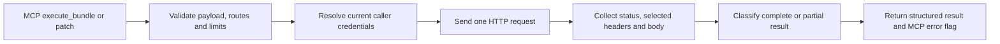

# FHIR Bundle execution and resource PATCH design

Status: implemented on `feature/fhir-bundle-patch` (2026-10-20), with local protocol tests and opt-in Aidbox acceptance. See [the user guide](bundle-and-patch.md). Implementation corrected the legacy Bundle routing assumption and expanded If-Match syntax for observed Aidbox ETags.
Date: 2026-10-19. Reviewed checkout: `2a915a4`, package version `0.10.0`.
Baseline: Python 3.12, `mcp==1.27.1`, `aiohttp==3.13.5`, `fhirpy==2.2.0`.

Design validation: all five JSON examples parse; referenced implementation files were checked. An in-memory FastMCP probe confirmed the pinned SDK advertises and returns the proposed `Annotated[CallToolResult, ResultModel]` structured output, including an empty-body success. This is not a test of an implemented FHIR feature or of the network protocol path. The design work did not change server implementation, deployment credentials, running services or clinical resources. The subsequent review response changes test fixtures and adds credential-isolation regression tests; see section 12.2.

Deployment follow-up (2026-10-20): a dedicated Aidbox writer client now replaces the root token locally. Direct HTTP checks verified current/stale If-Match, successful transactions, transaction rollback on forbidden entries and batch partial persistence. These are server interoperability checks, not implemented MCP-tool acceptance tests. See [local client permissions and renewal](aidbox-client.md). Subsequent MCP acceptance verified Parameters patches and characterized return preferences; see the implementation notes below.

This design adds two MCP tools: `execute_bundle` and `patch`. A small HTTP adapter preserves upstream status, headers, and response JSON. Existing tools keep their contracts. Aidbox is the first interoperability target, while the core contracts remain useful with other FHIR R4 servers.

## 1. Current implementation and consequences

| Location | Current behavior | Design consequence |
|---|---|---|
| `src/fhir_mcp_server/server.py:get_user_access_token` | Resolves configured bearer token or request-scoped MCP OAuth token | Reuse this identity resolution; never accept a token as a tool argument |
| `server.py:get_async_fhir_client` | Enforces authentication unless configured off, then constructs fhirpy client | Extract shared access-token authorization policy for both existing client and new transport |
| `server.py:create` | fhirpy special-cases unsaved Bundle and posts to the base; other resources use type routes | Reject Bundle types/payloads in create; require execute_bundle so validation cannot be bypassed |
| `server.py:update` | Executes PUT with a complete resource object | Add actual PATCH; do not emulate it with read/modify/PUT |
| `utils.py:get_default_headers` | Sets FHIR JSON content type for all current requests | New transport selects content type per operation |
| `utils.py:extract_bundle_resources` | Keeps only `entry.resource`; drops response-only entries and Bundle `type`, `total`, `link` and other metadata | Never call it on transaction/batch responses |
| `server.py:get_capabilities` | Requires a resource type and returns resource-level metadata | Add system capabilities and patch formats without breaking existing calls |
| `utils.py:get_capability_statement` | Fetches metadata without credentials and without project request timeout | Supply request-scoped authorization and configured timeout |
| `utils.py:validate_resource_id` | Allows empty IDs for existing conditional operations | PATCH must separately require a nonempty ID |
| `tests/e2e/conftest.py:RecordingFhirServer` | Records method/path, implements no PATCH, does not read request bodies | Extend to record selected headers and JSON bodies and script responses |

Installed fhirpy code was reviewed, not inferred from its method names. `AsyncClient.execute` can POST an empty relative path (rendered as `{base}/?` by its URL builder), but returns only the parsed body. Its private `_do_request` has optional status access, does not return response headers, and maps HTTP 412 to `MultipleResourcesFound`, which obscures stale-version PATCH failures. Its resource `patch(**kwargs)` uses field-object semantics rather than an explicit RFC 6902 document. These are poor foundations for the new response and error contracts.

The running Aidbox CapabilityStatement advertised `batch`, `transaction`, Patient `patch`, and `application/json-patch+json`. No mutation was made to establish those facts. Commit/rollback and PATCH behavior are now covered by the implementation acceptance test described in section 15.

## 2. Scope and implementation decisions

Deliver together:

- One `execute_bundle` tool accepting a complete FHIR Bundle of type `transaction` or `batch`.
- One `patch` tool for an existing resource identified by type and ID.
- Direct JSON Patch only. Bundle PATCH entries may pass through FHIRPath Parameters with envelope checks; no local FHIRPath evaluator or deep operation validator. Its interoperability test is required before claiming verified Aidbox Bundle PATCH support.
- A default-off write-tool registration switch covering existing create/update/delete and both new tools. Enabling writes requires deployment with a dedicated least-privilege identity.
- Request-specific `If-Match`, controlled `Prefer`, preserved status/headers, full response bodies, and meaningful MCP error flags.
- Bundle entry validation that keeps requests under the configured FHIR API and supports ordinary conditional CRUD/search requests.
- Discoverable server-level capabilities, plus regression and opt-in local Aidbox tests.

Explicit first-release boundaries: no direct conditional PATCH by search criteria, direct FHIRPath Patch, Merge Patch, XML Patch, Binary-wrapped JSON Patch entries, HEAD entries, arbitrary HTTP headers, arbitrary destination URLs, async-job polling, automatic retries, automatic pagination, client-side transaction simulation, or deep FHIRPath patch validation. Instance-route query strings are also excluded, including `Patient/123?_elements=...` and `_summary`; type-level searches retain these options. Bundle operation calls and history paths are outside the initial entry-URL grammar below; reject them explicitly rather than claiming universal FHIR Bundle execution.

The proposed scope is an adapter policy, not a statement that FHIR or Aidbox lacks the deferred features. Ordinary CRUD/search payloads, success-response shapes and tool names remain unchanged; create rejects Bundle types/payloads as an intentional compatibility exception. The default-off write-tool registration and revised discovery/create descriptions are explicit compatibility exceptions, detailed in section 9.

## 3. MCP tool contracts

### 3.1 `execute_bundle`

Conceptual signature:

```python
async def execute_bundle(
    bundle: dict[str, Any],
    prefer: Literal["minimal", "representation"] = "representation",
) -> Annotated[CallToolResult, FhirInteractionResult]: ...
```

Both new tools default to `representation`, giving callers the stored result when the server supplies it. `minimal` is an explicit option to reduce write-result payloads. `Prefer: return` controls successful create/update/patch representations (including such entries in a Bundle); it does not suppress GET results. A batch of reads requires no `prefer` override.

The input deliberately keeps the entire native Bundle. `bundle.type` is the sole execution-mode selector; there is no second mode argument that could disagree. Validate using pure helper functions and preserve the original JSON object, including explicit nulls and extensions. Do not rebuild clinical resources through narrow Pydantic models.

Tool description must explain:

- A transaction asks the server for atomic execution; a batch allows independent outcomes.
- This executes entries at the FHIR base endpoint and preserves complete per-entry outcomes. Legacy `create(type="Bundle")` reached the base through fhirpy but bypassed validation; it is now rejected with an instruction to use execute_bundle.
- Batch entries must not depend on another entry's successful creation.
- Repeating requests can duplicate records or repeat writes. A timeout is not evidence of rollback.
- Read each `entry.response.status`; HTTP success alone does not imply all batch entries succeeded.

Both new tools use conservative `ToolAnnotations`: `readOnlyHint=False`, `destructiveHint=True`, `idempotentHint=False`, `openWorldHint=True`. These are client hints, not authorization controls. A read-only batch still uses the conservative static annotation.

### 3.2 `patch`

```python
async def patch(
    type: str,
    id: str,
    payload: list[dict[str, Any]],
    if_match: str | None = None,
    prefer: Literal["minimal", "representation"] = "representation",
) -> Annotated[CallToolResult, FhirInteractionResult]: ...
```

Use `type`, `id`, and `payload` to match the current tools' naming. The initial tool accepts only JSON Patch arrays and always sends `application/json-patch+json`; it has no format selector. A later compatible extension can add an optional selector defaulting to JSON Patch after other formats are measured. Do not inject `resourceType` or `id` into the payload or fall back to another format after rejection.

`if_match` accepts a FHIR weak ETag such as `W/"7"`, a quoted ETag, or a bare Aidbox version token. Validate the version ID against the existing ID grammar, reject CR/LF, multiple tags and wildcard `*`, and pass it unchanged. Bare tokens were added after live acceptance found that the installed Aidbox returns them in its ETag header. Leaving it unset permits an unconditional instance PATCH; the description recommends it for changes based on an earlier read. Do not automatically read the resource or invent an ETag.

The description explains that indexed array changes are especially version-sensitive, a stale precondition must not be retried without reassessment, and omitting fields from a PATCH document does not have PUT's replacement semantics.

## 4. Shared outbound transport

Add `src/fhir_mcp_server/fhir_http.py` using the already installed aiohttp dependency. Avoid private fhirpy methods and avoid replacing existing fhirpy CRUD/search calls in this feature.



```python
@dataclass
class FhirHttpResponse:
    status: int
    headers: dict[str, str]  # selected response headers only
    body: Any | None
    body_is_json: bool

async def send_fhir_request(
    config: ServerConfigs,
    access_token: str | None,
    method: Literal["GET", "POST", "PATCH"],
    relative_path: str,
    body: Any | None = None,
    content_type: str = "application/fhir+json",
    if_match: str | None = None,
    prefer: Literal["minimal", "representation"] | None = None,
) -> FhirHttpResponse: ...
```

This is an internal helper, not a generic MCP HTTP tool. Only validated handlers construct its arguments.

Request construction:

1. Validate the complete input and limits before any outbound request, including metadata requests.
2. Enforce the write gate, then resolve authentication once for the call. Extract the current identity policy into a helper that returns a bearer string or permitted anonymous access and raises a dedicated `FhirAuthenticationError(Exception)` for missing required identity. Validators use `FhirInputError(Exception)` and metadata/HTTP failures use a transport-specific exception; none inherit from `ValueError`. Update existing tool catch sites to handle the dedicated auth exception as forbidden while ordinary ValueErrors become validation or internal failures, never authentication failures. Missing identity fails before network I/O; a metadata request failure is not proof that the caller lacks permission.
3. Normalize only the configured base URL's trailing slash. Require an HTTP(S) base with an authority and no userinfo, query, or fragment. An empty relative path selects exactly that base; otherwise append `/` and a locally constructed resource path. Do not use an untrusted absolute path with `urljoin`.
4. Create headers locally for this call: FHIR JSON Accept, selected Content-Type, optional bearer Authorization, optional If-Match, optional `Prefer: return=...`. Do not store credentials or mutable headers on a shared client.
5. Serialize once with strict JSON (`allow_nan=False`), UTF-8, preserving nulls and list order; measure these bytes for the request-size limit. Send those exact bytes with `data=`, not a second serializer.
6. Use `aiohttp.ClientTimeout(total=config.mcp_request_timeout)` and `allow_redirects=False`. Never automatically resend these mutation requests, including on authentication failure, 429, 503, or connection loss. Redirects become explicit upstream errors.
7. Read status and selected headers before decoding the body. A per-call `ClientSession` is consistent with current behavior and avoids cross-user header state; connection pooling is deferred.

Expose only `ETag`, `Location`, `Last-Modified`, `Content-Location`, `Preference-Applied`, `Retry-After`, and `Content-Type` as lowercase keys in the result. Never return cookies or authorization headers. Treat returned URLs as metadata; do not fetch them automatically.

Use a configurable response-byte ceiling while streaming, including for unexpected non-JSON error bodies. On overflow, stop reading and return a result-too-large error with the observed HTTP status and unknown mutation outcome; do not silently return a truncated Bundle or imply rollback. This limit is a guard against unusable MCP results, not a claim of full process-memory protection: MCP has already parsed the input before handler limits run.

## 5. Bundle validation and request behavior

### 5.1 Envelope and entries

Validate the following before POST:

- Top-level object with `resourceType == "Bundle"`, `type` exactly `transaction` or `batch`, and an `entry` array. Empty arrays are permitted as a no-op request; their handling is delegated to the server.
- Each entry is an object with a `request` object containing supported uppercase `method` and nonempty string `url`.
- Reject response/search fields on request entries. Preserve unrelated Bundle/entry fields; this is not a complete FHIR validator.
- Entry counts and serialized byte sizes fit configured limits.
- For creates/updates, body `resourceType` agrees with the URL target. An instance PUT body's ID, when provided, agrees with the URL ID. Never silently overwrite either.
- Preserve `fullUrl`, all clinical references, and request preconditions. Do not assign IDs, rewrite URNs, resolve references, or reorder/split entries in MCP.
- Validate `fullUrl` as a version-independent URI when supplied. Do not apply outbound URL restrictions to it or to resource references: these are data. Permit standard URNs and absolute resource identities. Leave full FHIR uniqueness/reference semantics to the server, rather than incorrectly rejecting every repeated fullUrl.
- Detect a limited, explicitly defined intra-batch dependency pattern: collect each POST entry's `fullUrl` when it starts with `urn:uuid:` or `urn:oid:`. Recursively traverse each entry.resource through dictionaries and arrays. Reject a string value whose key is exactly `reference` and whose entire value exactly matches a different POST entry's collected URN. No substring matching, URI decoding, case normalization, or scanning outside entry.resource. Ignore self-references and external URNs. This is a syntactic check, not a full FHIR Reference-type validator. It does not inspect Attachment.url, narrative links, canonical fields, or arbitrary strings; it cannot prove that a batch has no dependencies. The server remains authoritative. Tests must pin both detected and intentionally undetected examples.

FHIR defines native per-entry request and response fields; the implementation preserves them rather than translating them into repeated MCP calls. See [Bundle definitions](https://hl7.org/fhir/R4/bundle-definitions.html#Bundle.entry.request).

### 5.2 Initial supported entry routes

Here `Type` and `id` use the project's existing lexical validators; `criteria` is a nonempty query string. Method/route/body combinations outside this table return `not-supported` before POST.

| Method | Accepted `request.url` | Body and preconditions |
|---|---|---|
| GET | `Type`, `Type?criteria`, `Type/id` | No resource body; optional `ifNoneMatch`, `ifModifiedSince` |
| POST | `Type` | Resource object required; optional `ifNoneExist` query criteria |
| PUT | `Type/id`, `Type?criteria` | Resource object required; optional `ifMatch`/`ifNoneMatch` |
| DELETE | `Type/id`, `Type?criteria` | No resource body; optional `ifMatch`; reject unqualified type-wide delete |
| PATCH | `Type/id` | FHIRPath Parameters with envelope checks only; optional `ifMatch` |

Initially reject HEAD, `$operations`, `_history`, nested base transactions, compartment routes, instance-route queries, and conditional PATCH entries. GET `Type?criteria` supports existing complex search keys such as `_include:iterate`, `_revinclude`, chained keys, and repeated parameters. It returns one upstream search result; do not follow next-page links inside a transaction response.

Entry `request` fields are limited to the FHIR fields `method`, `url`, `ifNoneMatch`, `ifModifiedSince`, `ifMatch`, `ifNoneExist`, plus FHIR element metadata (`id`, `extension`, and primitive-extension companions). Reject a custom `headers` field. Validate precondition values as strings without control characters; `ifNoneExist` is query criteria, not a URL. Validate `ifModifiedSince` as a FHIR instant. Pass conditional criteria intact; MCP must not implement search-then-write.

### 5.3 URL boundaries

Implement a dedicated `validate_bundle_request_url`; the existing resource-ID validator is not a URL parser.

- Accept only relative `Type`, `Type/id`, or the allowed type-query forms. For interoperability, accept exactly one leading `/` and remove it in a copied outbound Bundle; reject `//`.
- Reject any scheme/authority, fragment, backslash, control character, whitespace in the path, empty internal segment, or dot-only path segment.
- For this deliberately narrow path grammar, reject all percent escapes in the path instead of repeatedly decoding it. Valid FHIR type/ID characters need no percent escaping. This blocks encoded separators and double-encoded traversal without heuristic decoding.
- Inspect the query separately. Query values may legitimately contain absolute URLs, URNs, slashes, or encoded characters. Do not apply path validation to values such as `identifier=https%3A...` or `_include=Observation:patient`.
- Reject malformed percent escapes and raw control characters in the query, but retain repeated parameters and their order. Reject a query on instance routes in this first version rather than silently ignoring it.
- `request.url` is never fetched by MCP itself; Aidbox receives it inside the Bundle. Local validation still prevents a caller from turning the credentialed integration into an arbitrary backend operation interface.

Examples to reject: `https://other.example/Patient`, `//other.example/Patient`, `../Patient`, `/../Patient`, `Patient/%2e%2e`, `Patient/%252e%252e`, `Patient\\123`, empty URL. Examples to accept: `Patient/123`, `/Patient/123`, `Patient?identifier=https%3A%2F%2Fexample.org%7C123`, repeated `_include` query keys.

### 5.4 Execution semantics and PATCH entries

Send one POST with FHIR JSON to the base endpoint. Do not fan out calls or chunk an oversized transaction. Return a validation error so the caller can intentionally reorganize it. A Bundle identifier is not an idempotency key.

Aidbox distinguishes execution at `POST /fhir` from storage at `POST /fhir/Bundle`. Transaction execution is atomic; batch execution can have mixed results. [Aidbox Bundle documentation](https://www.health-samurai.io/docs/aidbox/api/rest-api/bundle).

For PATCH inside a Bundle, `entry.resource` must itself be a FHIR resource. Accept FHIRPath `Parameters` in the initial standard R4 path. Do not put a raw JSON Patch array in `entry.resource` and do not invent per-entry Content-Type headers.

Defer Binary-wrapped JSON Patch and Merge Patch entries. The initial validator returns `not-supported` for these encodings. The documented Binary path needs separate sandbox evidence and a later design extension; it is not part of first-release acceptance.

## 6. Direct PATCH behavior

### 6.1 Request mapping

The direct tool accepts a JSON Patch array and sends `PATCH {base}/{type}/{id}` with `Content-Type: application/json-patch+json`. No `_method` query parameter or body-shape guessing is used. JSON Patch is the format advertised by the local Aidbox CapabilityStatement. Other Aidbox-documented patch formats are deferred, not presented as verified features. [Aidbox PATCH documentation](https://www.health-samurai.io/docs/aidbox/api/rest-api/crud/patch).

### 6.2 JSON Patch validator

Use a pure structural validator; do not fetch the resource to evaluate the patch locally.

- Require an array of objects. Permit an empty array as a no-op; enforce operation-count limit.
- Require `op` in `add`, `remove`, `replace`, `move`, `copy`, `test`, and a string `path`.
- Require the **presence** of `value` for add/replace/test, including valid values `null`, `false`, `0`, empty string, arrays and objects. Never use a truthiness check.
- Require string `from` for move/copy. Preserve additional operation members, which RFC 6902 permits recipients to ignore; do not let a restrictive model silently discard them.
- Validate JSON Pointer syntax: empty string is the document root; otherwise it starts with `/`; `~` escapes must be `~0` or `~1`. Do not use resource-ID rules for these pointers and do not URL-decode them.
- Leave existence, array index bounds, `-` meaning, equality of test values, and move-prefix semantics to the upstream implementation. Those depend on the current resource.
- Preserve operation order and value types. Do not inject defaults or remove nulls.

The format's operations and evaluation rules come from [RFC 6902](https://www.rfc-editor.org/rfc/rfc6902); pointer syntax comes from [RFC 6901](https://www.rfc-editor.org/rfc/rfc6901). Restrictions specific to FHIR identity and resource validity remain the server's responsibility.

### 6.3 Bundle FHIRPath envelope checks

For PATCH entries only, require an object with `resourceType == "Parameters"`, a `parameter` array, and each item an object with `name == "operation"` and a `part` array of objects. Bound the number of operation parameters by the same operation-count constant. Preserve the entire object, including nested typed values, resources and anonymous complex-element parts. Do not validate the operation grammar or parse/evaluate FHIRPath locally; let the server return a precise OperationOutcome. In particular, do not use the response-field extractor as a patch engine. [FHIRPath Patch specification](https://hl7.org/fhir/R4/fhirpatch.html).

Direct FHIRPath Patch, Merge Patch, XML, Binary wrapping and a deeper FHIRPath validator remain separate follow-up work. Their absence does not block the direct JSON Patch and transaction/batch feature.

## 7. Output and error contract

Both new tools return a common, explicitly versioned-by-documentation contract, independent of existing tools' raw resource returns:

```json
{
  "interaction": "transaction",
  "httpStatus": 200,
  "status": "success",
  "headers": {"content-type": "application/fhir+json"},
  "response": {
    "resourceType": "Bundle",
    "type": "transaction-response",
    "entry": [{"response": {"status": "201 Created", "location": "Patient/123/_history/1"}}]
  },
  "summary": {"entries": 1, "succeeded": 1, "failed": 0, "pending": 0, "unknown": 0},
  "error": null
}
```

Model `interaction` as `transaction|batch|patch|null`, with null for invalid/unsupported Bundle types; `httpStatus` is nullable when no HTTP response exists; `status` is `success|partial|failure|pending|unknown`. `summary` is nullable for PATCH. `response` is the upstream JSON body unchanged, or null if absent/not JSON. `error`, when present, is an adapter diagnostic object containing `kind`, a concise message, and an optional locally generated FHIR OperationOutcome. Keep upstream OperationOutcome in `response`, not a flattened issue list.

Return an explicit `CallToolResult` with this object in `structuredContent` and the identical JSON in a `TextContent` block for compatibility. Use `Annotated[CallToolResult, FhirInteractionResult]`; the installed SDK supports this output-model annotation and validates `structuredContent`. Add a protocol-level test for the actual advertised output schema. SDK argument-shape failures may occur before the handler and use the SDK error format; they must still send zero upstream requests.

Define stable adapter `error.kind` values: `validation`, `authentication`, `upstream-http`, `batch-entry-failure`, `network`, `timeout`, `protocol`, and `response-too-large`. A partial batch includes `batch-entry-failure` and its full response. Do not expose raw exception text, which may contain URLs, query criteria or upstream payloads. For a body containing sensitive server diagnostics, preserve it only in the authorized response field; adapter messages stay generic and actionable.

### 7.1 Classification rules

| Situation | Result classification | `isError` |
|---|---|---|
| Valid transaction response with all entries successful | `success` | false |
| Transaction response containing a failing/non-success entry | `unknown`, `error.kind=protocol`; preserve entire response; do not infer rollback or partial commit | true |
| Valid batch response, all entries successful | `success` | false |
| Valid batch with successes and failures | `partial`, full Bundle retained | true |
| Valid batch with every entry failed | `failure`, full Bundle retained | true |
| Entry 304 for conditional GET | Count as successful, not failure, including in transactions | depends on other entries |
| HTTP/entry 202 | `pending` if no failures; mixed with failures is `partial` | false unless failures |
| PATCH 2xx with a resource, informational OperationOutcome, or no body | `success` except 202 | false |
| HTTP 4xx/5xx with JSON OperationOutcome | `failure`; preserve status/body | true |
| Local validation/authentication rejection | `failure`, null HTTP status, local diagnostic | true |
| Network timeout/disconnect after possible dispatch | `unknown`; outcome may have committed | true |
| DNS/connect refusal before any dispatch | `failure`; request was not sent | true |
| Invalid/missing transaction response, truncated JSON, unexpected non-JSON success, oversized response | `unknown`; report protocol/size issue | true |

Apply the transaction protocol-error rule before batch aggregation. A transaction entry status outside 2xx is invalid except an expected 304 for a conditional GET. A 304 on a write is a protocol error; an outer 202 is pending, not a completed transaction. For batch results, if both failures and pending entries exist, `partial` takes precedence; preserve counts so the caller sees both. For a malformed entry status, mark the overall result `unknown`, preserve the body and all parseable counts. Reject a mismatched response Bundle type or wrong entry count as an ambiguous protocol result; never fabricate missing entry outcomes.

For valid Bundle responses, parse only the leading three-digit `entry.response.status`, preserve its original string, and associate by input position. Retain `response.location`, `etag`, `lastModified`, `outcome`, resource bodies, nested search Bundles, and all extensions. Do not run the response through `extract_bundle_resources` or FHIRPath output filtering.

HTTP 200 containing an error/fatal top-level OperationOutcome is a failure, not success. A successful PATCH body with an unexpected shape/resource identity is an unknown protocol result. A no-body PATCH success is legitimate even when `Prefer: return=representation` was requested; expose the actual ETag and no invented resource. An empty-body Bundle response is insufficient to establish its per-entry outcome.

Treat 401, 403, 404, 409, 412, 415 and 422 distinctly using HTTP status and any supplied OperationOutcome. In particular, never map every 412 to multiple search matches. For non-JSON error pages, report content type and HTTP status without echoing arbitrary HTML or upstream bodies into diagnostics/logs.

No `rolledBack: true` field is synthesized. Even when a server is expected to roll back transactions, a gateway failure or lost response leaves uncertainty. Tool descriptions and error messages instruct callers to reconcile current server state before considering a retry. Successful batch entries must not be replayed just because the tool-level error flag is true.

## 8. Capability discovery and authentication

Extend `get_capabilities(type: str = "")` additively:

- With a resource type, retain existing fields and add `patchFormat` (server-level format list) and the resource's `versioning`, `conditionalCreate`, `conditionalUpdate`, and `conditionalDelete` metadata when present.
- Branch on `type == ""` **before** calling `validate_resource_type`: the existing validator rejects empty strings. With no type, return `fhirVersion`, `patchFormat`, server REST `interaction`, a server operation count, and supported resource type names. Include the full server operation list only when `include_operations=True`; resource-level operations remain unchanged. Select a `rest` entry with `mode == "server"`; do not assume `rest[0]` is always it.
- Replace the existing "MUST always be invoked" description with "Use to discover resource or system capabilities when needed; results are advisory and do not authorize a write." Explain resource vs system lookup without making it a mandatory preceding call. Do not claim it returns full profile schemas.
- Use the same identity policy and timeout for metadata. Retain the helper's httpx-based implementation with optional authorization/timeout parameters for compatibility, but pass `follow_redirects=False` on `client.get(...)`: the MCP SDK factory otherwise enables redirects. Do not attempt to pass an unsupported redirect flag to the factory. Report 3xx as metadata transport failures, never follow them or resend credentials. Add a two-local-server regression test proving the redirect destination receives no request. Distinguish `FhirAuthenticationError` from metadata failures and do not set global headers.

Capability discovery is advisory, not a per-write round trip or a mandatory local veto. Metadata can omit supported features (the live server's format list is narrower than Aidbox's documentation). The server is authoritative for actual support and access policy; preserve 405/415/501 responses. Do not globally cache capabilities under one user's token and reuse them for another user. Start without a new cache.

The underlying fields are defined in [CapabilityStatement](https://hl7.org/fhir/R4/capabilitystatement-definitions.html). This feature does not add token acquisition/refresh or per-user login setup. It adds a local registration gate, while the server still enforces data permissions. Before enabling writes, configure a dedicated Aidbox client limited to required resource types and operations; an unrestricted root token is not the deployment identity prescribed for enabled write tools. The local deployment now uses a dedicated scoped client. The adapter cannot infer least privilege from an opaque token; operator provisioning and negative authorization tests establish that property.

## 9. Configuration, compatibility, and observability

Settings:

| Environment variable | Default | Scope |
|---|---:|---|
| `FHIR_MCP_ENABLE_WRITE_TOOLS` | `False` | Registration and handler checks for create/update/delete/execute_bundle/patch |
| `FHIR_MCP_MAX_INTERACTION_REQUEST_BYTES` | 1048576 | UTF-8 JSON bytes for either new interaction tool |
| `FHIR_MCP_MAX_INTERACTION_RESPONSE_BYTES` | 8388608 | Decoded response-stream bytes for the new transport |

Use named constants `MAX_BUNDLE_ENTRIES = 100` and `MAX_PATCH_OPERATIONS = 100` initially rather than two more environment settings. The latter bounds JSON Patch operations and Bundle FHIRPath operation parameters. Retain the request and response byte settings because deployments have different payload sizes; all limits are adapter choices, not FHIR limits. Reuse `FHIR_MCP_REQUEST_TIMEOUT`. Reject oversized input before network I/O and never split transactions automatically.

Write gating is an intentional default-behavior change. If disabled, do not register `create`, `update`, `delete`, `execute_bundle`, or `patch`, and also reject calls inside their handlers before resolving identity or sending HTTP if invoked through an internal path. Even read-only batches require enabling `execute_bundle`; selective batch registration is deferred. Read/search/capability/user-profile tools remain. Existing GET custom-operation support means this switch is not a complete security boundary or proof of a read-only backend identity: server access policies are still required. The earlier design-only revision did not enable the switch. The user subsequently authorized implementation and a dedicated client; local activation is a separate deployment step.

Document the migration explicitly: existing users who intentionally need write tools must provision the appropriate identity and opt in. With writes enabled, existing tool names, argument schemas and output shapes stay unchanged. Intentional metadata changes are the defaulted capabilities argument, revised advisory capabilities description, and the create description pointing to `execute_bundle`. These description changes are compatibility exceptions, not silent claims of identical contracts. Add a README link explaining the new result envelope and write migration.


Log tool name, method, interaction kind, entry/operation count, HTTP status, duration and an adapter-generated correlation ID. Do not log bearer tokens, patch values, Bundle contents, conditional query values, or full clinical upstream errors, including at DEBUG. Existing tools currently log some payloads at DEBUG; remediating their broader logging is separate work, but new code must not copy that pattern. MCP result content still includes authorized data for the requesting caller.

## 10. Examples of the proposed tools

### 10.1 Transaction with a new Patient and referenced Observation

```json
{
  "bundle": {
    "resourceType": "Bundle",
    "type": "transaction",
    "entry": [
      {
        "fullUrl": "urn:uuid:8f7d9077-b261-4fce-b9fd-3100d134c001",
        "resource": {"resourceType": "Patient", "active": true},
        "request": {"method": "POST", "url": "Patient"}
      },
      {
        "fullUrl": "urn:uuid:8f7d9077-b261-4fce-b9fd-3100d134c002",
        "resource": {
          "resourceType": "Observation",
          "status": "final",
          "code": {"coding": [{"system": "http://loinc.org", "code": "8867-4"}]},
          "subject": {"reference": "urn:uuid:8f7d9077-b261-4fce-b9fd-3100d134c001"},
          "valueQuantity": {"value": 72, "unit": "beats/minute", "system": "http://unitsofmeasure.org", "code": "/min"}
        },
        "request": {"method": "POST", "url": "Observation"}
      }
    ]
  },
  "prefer": "representation"
}
```

### 10.2 Independent batch reads

```json
{
  "bundle": {
    "resourceType": "Bundle",
    "type": "batch",
    "entry": [
      {"request": {"method": "GET", "url": "Patient/example-patient"}},
      {"request": {"method": "GET", "url": "Observation?patient=Patient%2Fexample-patient&_count=5"}}
    ]
  }
}
```

### 10.3 JSON Patch with a version precondition

```json
{
  "type": "Patient",
  "id": "example-patient",
  "if_match": "W/\"7\"",
  "payload": [
    {"op": "test", "path": "/active", "value": true},
    {"op": "replace", "path": "/active", "value": false}
  ]
}
```

The caller must supply the actual version from a prior read. Example IDs and versions are illustrative, not records to mutate in the current deployment. Headers and update/patch conditional behavior are described in the [FHIR R4 HTTP specification](https://hl7.org/fhir/R4/http.html#patch).

### 10.4 FHIRPath PATCH inside a transaction

```json
{
  "bundle": {
    "resourceType": "Bundle",
    "type": "transaction",
    "entry": [
      {
        "request": {"method": "PATCH", "url": "Patient/example-patient", "ifMatch": "W/\"7\""},
        "resource": {
          "resourceType": "Parameters",
          "parameter": [{"name": "operation", "part": [
            {"name": "type", "valueCode": "replace"},
            {"name": "path", "valueString": "Patient.active"},
            {"name": "value", "valueBoolean": false}
          ]}]
        }
      }
    ]
  }
}
```

## 11. Files and implementation sequence

| File | Planned change |
|---|---|
| `src/fhir_mcp_server/server.py` | Gate all five write tools; register new tools; shared typed identity policy; additive capabilities and description changes |
| `src/fhir_mcp_server/fhir_http.py` (new) | Request construction, timeout/redirect policy, status/header/body collection, size limits |
| `src/fhir_mcp_server/interactions.py` (new) | Result models, typed exceptions, validators, bounded constants and result classification; split only when implementation size warrants it |
| `src/fhir_mcp_server/utils.py` | Authenticated metadata options; existing response-flattening helper untouched |
| `src/fhir_mcp_server/oauth/types.py` | Default-off write gate and two validated byte limits |
| `.env.example`, `README.md`, `tests/README.md` | Settings, tool arguments, examples, response interpretation, test commands |
| `tests/unit/test_interaction_validation.py` (new) | Structural, route, pointer, header and size boundaries |
| `tests/integration/test_fhir_http.py` (new) | Real local HTTP fixture for headers/status/body/error behavior |
| `tests/e2e/test_bundle_patch.py` (new) | MCP-to-stub tests of new tools and schemas |
| `tests/e2e/conftest.py` | Rich recorder, isolated subprocess env, optional ephemeral ports |
| `tests/aidbox/test_bundle_patch.py` (new) | Explicitly enabled sandbox interoperability tests |

Recommended sequence:

1. Default-off write gating, typed auth errors, models, validators and HTTP adapter with focused boundary tests.
2. Bundle tool and error classification; MCP tests proving exact base URL, a single POST, and response preservation.
3. JSON Patch tool, version preconditions and empty-body responses; Bundle Parameters envelope pass-through.
4. Capability extension, configuration, documentation and compatibility tests.
5. Opt-in Aidbox acceptance using a restricted test client, including Parameters patches inside Bundles. Record the server build; resolve unsupported paths before claiming verified support. Binary and Merge Patch experiments belong to later work.

Do not make a dependency upgrade part of this feature. If the pinned MCP result annotation fails the protocol tests, resolve that specifically before adding a new SDK version. The design is not contingent on upgrading fhirpy.

## 12. Test and acceptance plan

### 12.1 Pure validation tests

- Bundle types, missing/mistyped requests, empty Bundle, entry limits, exact byte limit including Unicode; reject Binary PATCH entries.
- Every accepted method/route/body combination; each unsupported route fails explicitly.
- Host/path escape cases including single leading slash normalization, scheme-relative URLs, encoded and double-encoded separators, dot segments, fragments, backslashes and control characters.
- Valid queries containing URLs, encoded identifiers, repeated parameters, `_include:iterate`, `_revinclude` and chaining remain intact.
- Request preconditions and body type/ID consistency; legitimate URN/absolute fullUrl and resource references are not mistaken for outbound destinations.
- JSON Patch false/null/zero values, empty documents, all six operations, pointers with escaped `/` and `~`, root pointer, invalid escapes and wrong body shape.
- FHIRPath envelope preservation, including nested values, with semantic errors delegated to the server; reject unsupported direct patch body shapes.
- Static limits and local validation reject before any HTTP request.

### 12.2 HTTP and MCP tests against a recording server

Extend the recorder with `do_PATCH`, body reading, selected-header capture and queued status/header/body responses. Record only dummy test credentials. Use a base path such as `/tenant/fhir` to expose accidental root-path escapes.

Assert:

- Bundle call issues exactly one `POST /tenant/fhir`, never `/Bundle` or multiple entry calls; PATCH issues `PATCH /tenant/fhir/Patient/123`.
- Correct bearer token selection, anonymous mode, missing-auth failure and no credential/header leakage between calls.
- JSON Patch vs FHIR Bundle content types; exact list/object bodies, explicit nulls, If-Match and Prefer propagation. Minimal does not remove GET resources from batch results.
- No redirect following or automatic retry; delayed/disconnected responses produce unknown outcomes, not invented rollback claims.
- Full Bundle equality in `response`, including response-only DELETE entries and nested search Bundles.
- Partial batch failures, a malformed transaction containing a failure entry, conditional-GET 304 entries vs invalid write 304, 202 pending, malformed status, wrong count/type and upstream OperationOutcome handling.
- PATCH 200 representation and 204 no body, stale 412, 404, 403, unsupported 415, non-JSON failure, invalid JSON and response-size ceiling.
- Both tools have usable input/output schemas and conservative annotations; text and structured output agree; expected error conditions set `isError`.
- Default configuration lists none of the five write tools; unknown-tool calls and direct gated handlers make no upstream request. Explicitly enabled configuration lists all five. With writes enabled, existing `create(type="Bundle")` and Bundle payloads under other types are rejected before identity resolution or HTTP, with an explicit MCP error directing callers to execute_bundle. Discovery descriptions and system-level empty-type branch match the new documented behavior.
- Missing identity raises the dedicated auth exception; invalid input and metadata failures never become false forbidden responses. Metadata redirects receive no follow-up request or credentials.
- Valid and invalid tests both reach the same recording boundary; positive controls prevent vacuous no-request assertions.

Credential isolation is an immediate prerequisite for **existing and new** tests, not a future feature. The shared `run_mcp_server` fixture now uses `build_mcp_test_environment`: remove inherited `FHIR_*` keys, explicitly set all current test connection settings, and override access token, client ID, client secret and scopes with empty values. Empty overrides are essential because removing keys alone lets `ServerConfigs` reload `.env`. The same helper serves both the existing public fixture and local recorder.

This review response also switches the launcher to `sys.executable -m fhir_mcp_server`, so it uses pytest's environment without requiring global uv. Added unit tests launch configuration probes in temporary directories containing fake `.env` credentials, both with and without inherited fake credentials. A separate MCP-to-loopback regression asserts exactly one successful FHIR request and no Authorization header; it records only header presence, never values. These tests do not contact HAPI or Aidbox. Public live tests still exist and still write test data when deliberately selected; they were excluded from verification here.

When write gating is implemented, fixtures that intentionally exercise writes must set `FHIR_MCP_ENABLE_WRITE_TOOLS=True` explicitly. Add separate default-off tests; do not depend on the developer's `.env` choice. Keep Windows process-tree teardown and prefer dynamically allocated ports in future fixture work.

### 12.3 Opt-in Aidbox acceptance

Require a separate configured sandbox endpoint, explicit test-enable flag, write-tool opt-in, and a dedicated least-privilege test identity. Verify that the identity cannot write an unrelated resource type or call administrative operations before the write scenarios. Generate synthetic resources with unique run identifiers and delete only resources created by that run, dependents first. Never reuse or alter the existing seeded patients. Do not run destructive acceptance against the default public HAPI fixture.

| Scenario | Required observation |
|---|---|
| Transaction creates linked resources | Both exist; server resolves the fullUrl reference; response entries correlate correctly |
| Transaction contains a guaranteed failing entry | Newly attempted resources do not exist afterward; record actual response/status |
| Batch has valid and invalid entries | Successful entry persists, failed entry is visible; no whole-batch retry |
| Conditional create | Repeating a unique identifier condition does not duplicate the resource |
| Instance JSON Patch | Intended field changes; unrelated fields remain; actual returned version/header preserved |
| Stale If-Match | Upstream rejects and resource remains unchanged; do not assume an exact code until observed |
| Failed JSON Patch test operation | No later patch operation takes effect |
| Transaction PATCH | FHIRPath Parameters pass-through works; invalid operation semantics surface the server error |
| Transaction failure after a PATCH | Resource's pre-transaction content is retained |
| Minimal response preference | Actual body/header behavior handled without fabricated resource content |

Persist measured server build and behavior in the shared knowledge base without tokens or clinical data. Deferred formats require separate evidence before an extension is implemented or advertised.

Implementation test commands, once the named files exist:

```powershell
.\.venv\Scripts\python.exe -m pytest tests/unit tests/integration tests/test_utils.py -q
.\.venv\Scripts\python.exe -m pytest tests/e2e/test_bundle_patch.py -q
# Run tests/aidbox only after explicit sandbox configuration and opt-in.
uv build --python 3.12
```

Completion means: new tools discoverable over MCP, request/response contracts covered by local protocol tests, existing suite passes, transaction rollback and batch partial success measured on the sandbox, JSON Patch concurrency verified, Bundle Parameters pass-through characterized and deferred formats clearly excluded, and README examples match tested tool schemas. Documentation-only work does not satisfy these implementation acceptance criteria.

## 13. Alternatives considered

- Reuse `create("Bundle")`: legacy flattening destroys response semantics and the generic tool lacks the new validation/output contract. The earlier claim that it uses the wrong endpoint was disproved: fhirpy routes an unsaved Bundle to the base.
- Execute Bundle entries as individual tool calls: cannot preserve atomicity, reference resolution or conditional-write behavior.
- Call fhirpy's private `_do_request`: couples the feature to internals and still loses headers; its 412 exception classification is unsuitable here.
- Use fhirpy's resource `patch(**kwargs)`: does not provide the required explicit JSON Patch/Parameters contract.
- Read, merge locally, then PUT: changes concurrency and partial-access semantics and risks overwriting unrelated fields.
- Return only a resource or raw issues: cannot faithfully represent no-body success, version conflicts, partial batch outcomes, and uncertain writes.
- Add a generic URL/method/header MCP tool: unnecessary capability and a much larger request-validation boundary.
- Implement every FHIR operation inside Bundle immediately: broader route and body semantics deserve separate tests. The first release declares its supported subset instead of silently accepting untested operation routes.

## 14. Remaining verification and review disposition

The revised first release has two new modules, a default-off write switch, two byte-limit settings, direct JSON Patch, and Parameters envelope pass-through inside Bundles. Acceptance now covers rollback, partial batch persistence, concrete If-Match failures, Parameters interoperability, response preferences and configurable size limits. The defaults remain adapter policy, not a measured maximum for production workloads. Deferred Binary/Merge/direct FHIRPath support is not a release blocker.

The review's Python-launcher criticism needs qualification: `py -3.14 -m uv` launches uv under that interpreter; uv independently selects the project interpreter from `.python-version`. The prior build did use Python 3.12, so this was not a demonstrated build mismatch. The portable command above makes the target explicit. On this workstation, where uv is not on PATH, the equivalent is `py -3.14 -m uv build --python 3.12`.

The fixture leak was confirmed as a configuration path, not an observed exfiltration event. The recorded earlier pytest run excluded e2e; this is evidence about that run, not a claim about every command ever executed on the machine. The fixture fix, regression tests and this revised document are the only implementation changes in the review response; that review response did not implement the new tools; the subsequent implementation is recorded below.


## 15. Implementation evidence (2026-10-20)

Two assumptions were corrected by protocol/live tests rather than changing existing behavior to fit the proposal:

- fhirpy 2.2.0 `get_resource_path` returns an empty path for an unsaved Bundle. Legacy `create(type="Bundle")` posts to the base, not `/Bundle`. A recorder proved this; the initial implementation preserved that path. PR review then identified its validation bypass, so create now rejects Bundle types/payloads and directs callers to execute_bundle.
- Local Aidbox emits a bare version token in ETag. PATCH accepts that bounded syntax as well as weak/strong quoted tags, preserving the supplied value. Wildcards, multiple tags and controls remain rejected.

The opt-in Aidbox test passes through MCP: linked-resource transaction resolution, rollback, partial batch persistence, conditional create, current/stale If-Match (412), failed JSON Patch test (422), Parameters PATCH inside a transaction, rollback after PATCH, and response preferences. All run-created resources were cleaned up.

This Aidbox build returns HTTP 200 with no body for minimal direct PATCH. It also omits GET resources from batch responses under `return=minimal`, despite the intended write-only semantics of the preference. Default `representation` returns them. The adapter preserves actual server behavior; it does not invent resources or silently override the preference.

Measured image: `healthsamurai/aidboxone:edge`, digest `sha256:fab094fbfcf5e02bc05e79a51934229c8eeed9832036f3e7d0fdb8228be6c165`, created 2026-08-18. CapabilityStatement did not expose a software version.


## 16. PR review follow-up

L-2: distinguish missing/invalid resource IDs, missing/non-string/malformed patch
pointer members, and invalid If-Match forms. Unsupported Bundle types return
`interaction: null`, not a fabricated transaction mode.

L-4: system capability discovery returns `operationCount` by default; a full list
requires `include_operations=True`. Resource-level discovery keeps its existing
operation behavior.

M-1: `create` rejects both Bundle tool types and Bundle payloads, before credential
resolution or HTTP, using an MCP tool error. This intentionally replaces the earlier
compatibility decision: otherwise callers could bypass execute_bundle's checks.
Other legacy error handling and non-Bundle payload-type mismatches remain separate.
